# 收藏空间 · Bookmark Space

把浏览器里越积越多的收藏，整理成可以搜索、按分类浏览的卡片和图谱。

这是 **0.5.3 Beta**。点击扩展图标打开收藏空间，不替换新标签页。不接 AI 也能使用；无需部署服务器或安装数据库。

[](https://github.com/chyc20210823/bookmark-space/raw/refs/heads/main/docs/walkthrough.mp4)

**[下载完整操作视频（MP4，约 26 秒）](https://github.com/chyc20210823/bookmark-space/raw/refs/heads/main/docs/walkthrough.mp4)** · [安装方法](#安装) · [打开与使用](#打开与使用) · [配置 AI](#配置-ai) · [隐私说明](PRIVACY.md)

动态图和视频均来自真实插件操作，使用 22 条公开网站组成的示例收藏，不含个人书签或 Key。演示采用本机规则，没有调用 AI。安装后显示你自己的浏览器收藏。

## 先看效果

### 收藏图谱：从主题找到具体文章

点击大类进入子类，再展开到文章节点；点击文章查看详情，可以继续打开原网页。画布支持拖动、缩放和沉浸查看。

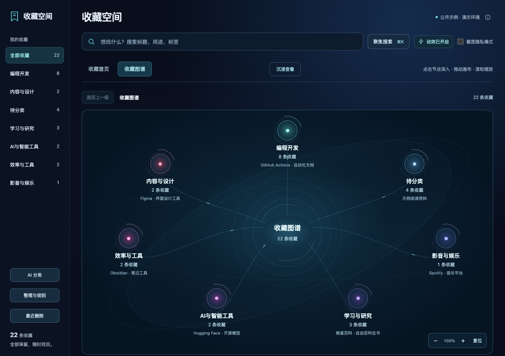

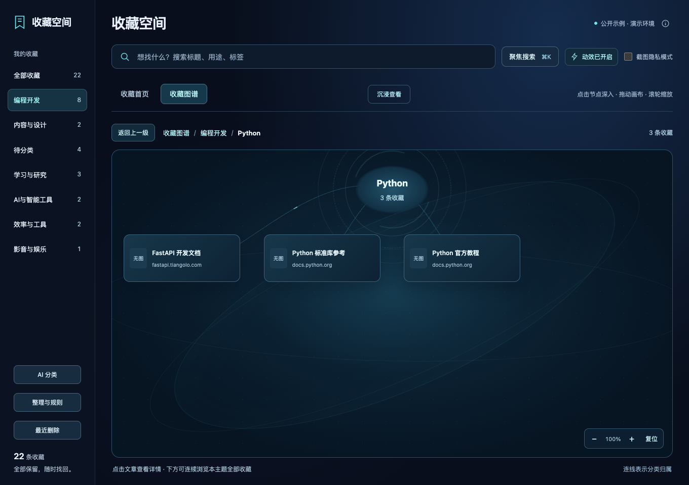

### 分类规则：不接 AI，也能自动整理

内置 89 条规则，结合标题、域名、网址路径和原文件夹分类。你也可以添加自己的规则。下面把 `example.com` 归入「学习与研究 / 待读资料」，保存后这条示例收藏就完成了归类。

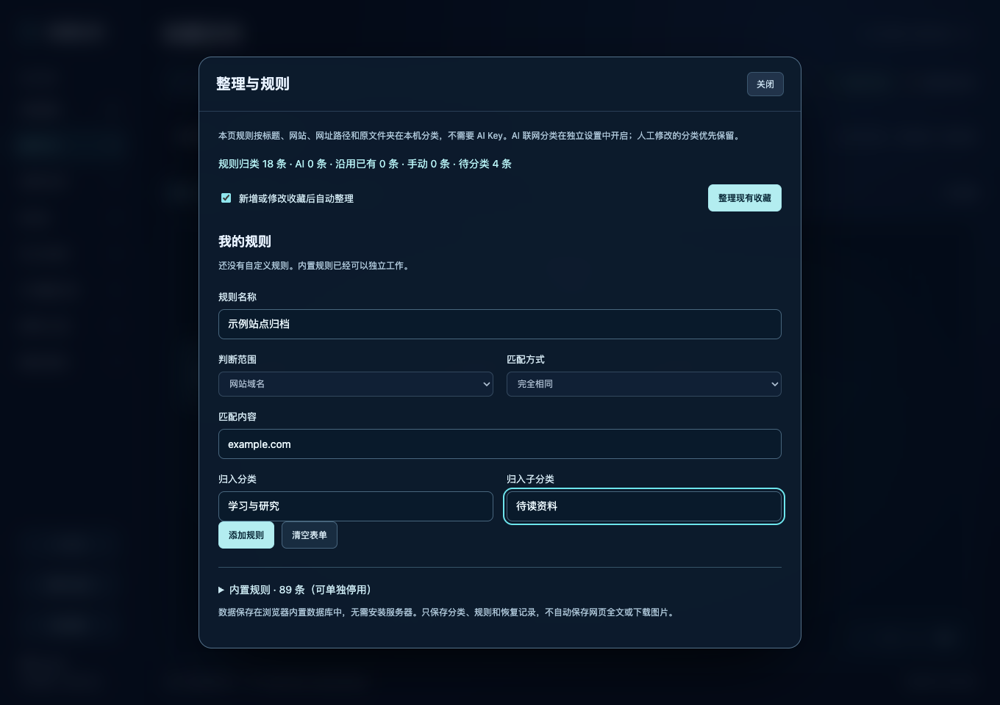

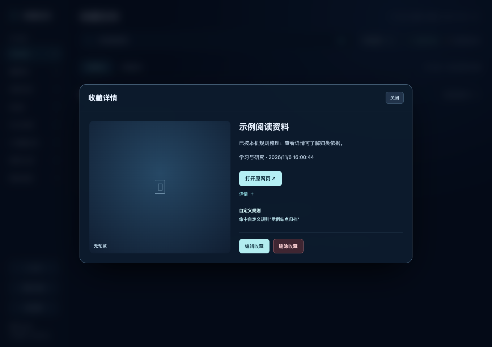

<details>
<summary>查看规则保存结果和内置规则列表</summary>

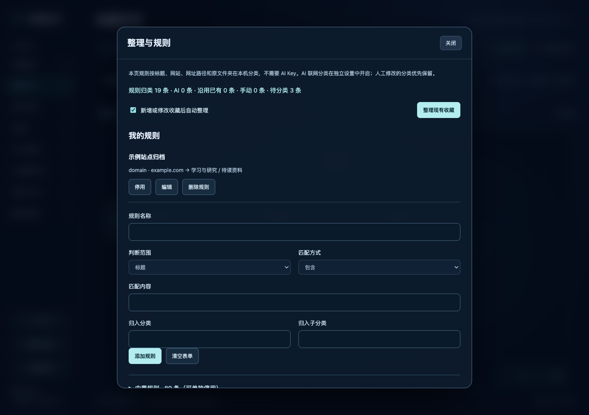

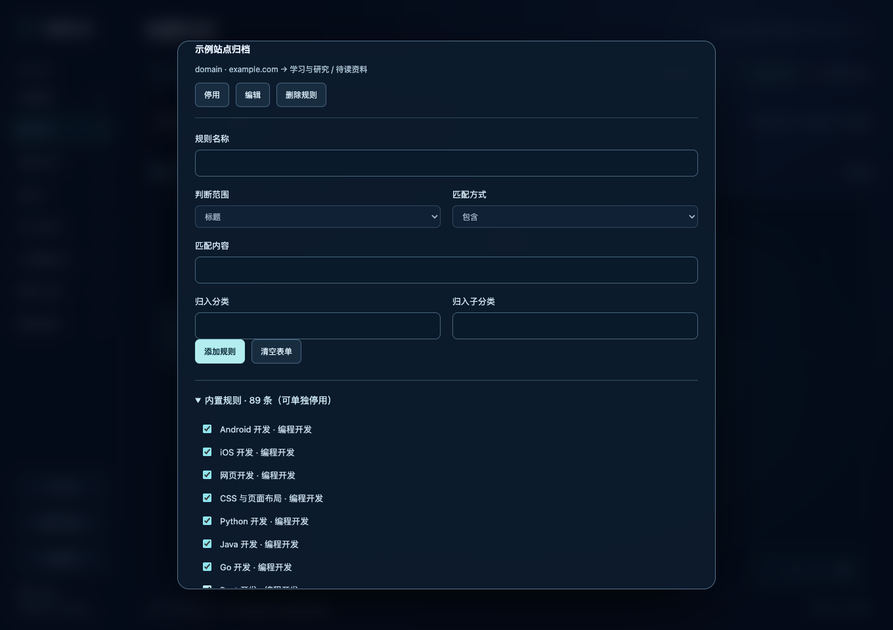

</details>

### 分类不用先清空，再换一个

0.5.1 的分类选择器会先保留当前值，点开即可浏览全部候选；在独立搜索框输入关键词，可以筛选已有分类或明确新建。子分类跟随大类，改错了也可以取消。编辑收藏和添加规则使用同一套操作。

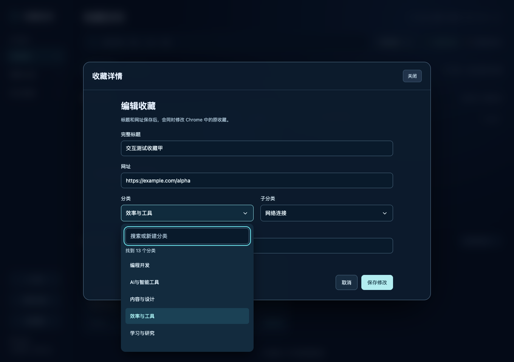

### 收藏首页与详情

最近收藏放在最前面，下面按卡片浏览。标题直接打开网页，“查看详情”显示分类依据，并提供编辑、删除入口。

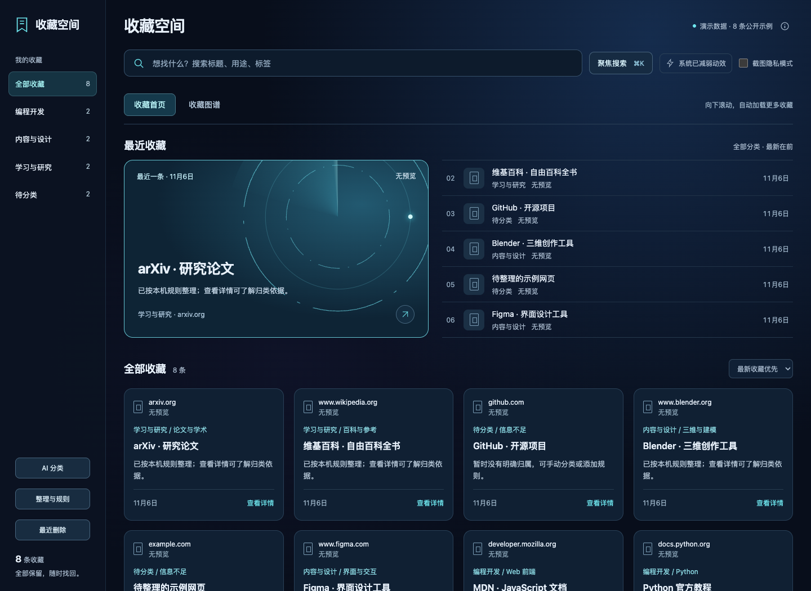

<details>
<summary>查看文章详情弹窗</summary>

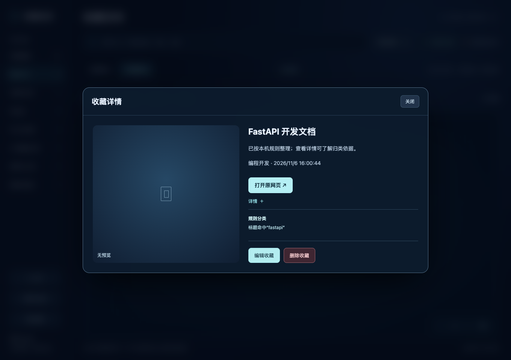

</details>

## 可以做什么

- 读取当前浏览器收藏，监听新增、修改、删除，最近收藏优先展示。
- 卡片、分类图谱和聚焦搜索；滚动时自动加载，标题链接直接打开原网页，详情按钮打开弹窗。
- 本机规则分类，可添加自己的规则和手动分类；详情展示分类来源与依据。
- 编辑标题、网址会写回浏览器。删除前确认，支持撤销和“最近删除”恢复。
- 可选 DeepSeek、Kimi、OpenAI、Claude、Grok、Gemini 官方 API，使用你自己的 Key；支持预设和自定义模型 ID。
- AI 默认关闭。开启后可补充待分类项，不确定的结果和新大类先交给你确认。

分类和标签属于插件自己的数据，不会自动移动浏览器原有文件夹。AI 只根据标题、网址和分类名称判断，不读取网页正文，也不保证分类正确。

## 安装

1. 在本仓库页面点击绿色 **Code → Download ZIP**，下载后解压到一个长期保留的文件夹。
2. 在 Chrome 地址栏输入 `chrome://extensions`。
3. 打开“开发者模式”，点击“加载已解压的扩展程序”。
4. 选择项目里的 **extension 文件夹**，该文件夹中应有 `manifest.json`。
5. 确认扩展管理页出现“收藏空间”，并且开关已开启。接下来按下面的方法打开。

安装不需要 Node.js、Python 或任何数据库。不要双击 `newtab.html` 当作插件使用，也不要删除安装目录。更新时替换同一目录的文件，再到扩展管理页点“重新加载”。

安装步骤依据 [Chrome 官方说明](https://developer.chrome.com/docs/extensions/get-started/tutorial/hello-world#load-unpacked)。本项目尚未上架 Chrome 应用商店。

## 打开与使用

### 装好后，从哪里打开？

1. 在 Chrome **地址栏右侧**点击拼图形状的 **“扩展程序”** 按钮。
2. 在列表里找到 **“收藏空间”**，点击名称，即可打开收藏管理页面。
3. 建议点击它旁边的 **图钉**，固定到工具栏。以后点击地址栏旁的扩展图标就能打开，鼠标悬停时会显示“打开收藏空间”。

打开的是浏览器内的完整页面。关闭页面后可以再次点击扩展打开；页面已经打开时，会切换到现有页面。点击浏览器的“＋”仍是正常的新标签页，不会自动进入收藏空间。

扩展入口与固定方法可参考 [Chrome 官方教程](https://developer.chrome.com/docs/extensions/get-started/tutorial/hello-world#pin_the_extension)。

### 第一次打开，先做什么？

页面会读取**当前 Chrome 用户配置中的收藏**，无需先导出或导入文件。本机规则默认开启，不需要 AI Key。

| 想做什么 | 在哪里操作 |
| --- | --- |
| 找最近收藏的网站 | “收藏首页”最上方查看最近收藏，或用顶部搜索框搜索标题、网址、分类和标签 |
| 按主题浏览 | 点击左侧分类；也可以切换“收藏图谱”，逐层点击大类、子类和文章节点 |
| 打开原网页 | 点击卡片标题；图谱文章先打开详情，再点“打开原网页” |
| 查看分类依据 | 点击卡片“查看详情”，查看规则、手动分类或 AI 的来源说明 |
| 调整一条收藏 | 在详情中点击“编辑收藏”；分类点开即可选，输入关键词搜索，也可明确新建 |
| 补充分类规则 | 点击左下方“整理与规则”，添加规则，或点击“整理现有收藏”重新整理 |
| 使用 AI 辅助分类 | 到“AI 设置”配置服务；到“AI 整理”查看进度、确认建议和重试失败项 |

以后继续用 Chrome 地址栏的星标收藏网页即可。插件会监听新增、修改和删除；保持“整理与规则”中的“新增或修改收藏后自动整理”开启，新收藏就会按规则尝试分类。信息不足的条目保留在“待分类”，可以手动调整、添加规则或交给 AI 辅助判断。

**在插件中修改标题、网址或确认删除，会同步影响当前浏览器的原收藏。** 插件里的分类和标签不会自动移动 Chrome 原有收藏文件夹。

### 找不到入口，或打开后没有收藏？

- **扩展列表里没有“收藏空间”**：进入 `chrome://extensions`，确认已加载的是项目里的 `extension` 文件夹，并且扩展开关已开启。
- **页面显示 0 条收藏**：确认当前 Chrome 用户配置里有收藏。不同 Chrome 用户配置、Chrome 和 Edge 各自读取自己的收藏。
- **更新后点击无反应**：在 `chrome://extensions` 找到“收藏空间”，点击重新加载，再从扩展菜单打开。安装文件夹需要保留。

## 配置 AI

先用本机规则体验，再按需打开侧栏“AI 设置”：

1. 选择 AI 服务，粘贴该服务的 API Key。
2. 阅读并勾选发送范围与费用说明，点击“连接并开启自动整理”。
3. 在浏览器提示中允许连接。插件会保存 Key、检查连接，成功后才开启自动整理。

首次使用会选择默认模型，默认只补充待分类收藏，每天最多请求30次。不需要先选择模型 ID 或逐个配置开关。需要自定义模型、修改上限或只保存配置时，再展开“高级设置（通常不用改）”。连接失败会保留本机 Key，并保持自动整理关闭，页面会说明原因。

“AI 设置”只管连接和配置；“AI 整理”专门查看待确认、已完成和失败结果。下面是隔离测试中的示例界面，使用假 Key 和模拟分类结果，不代表真实模型准确率。

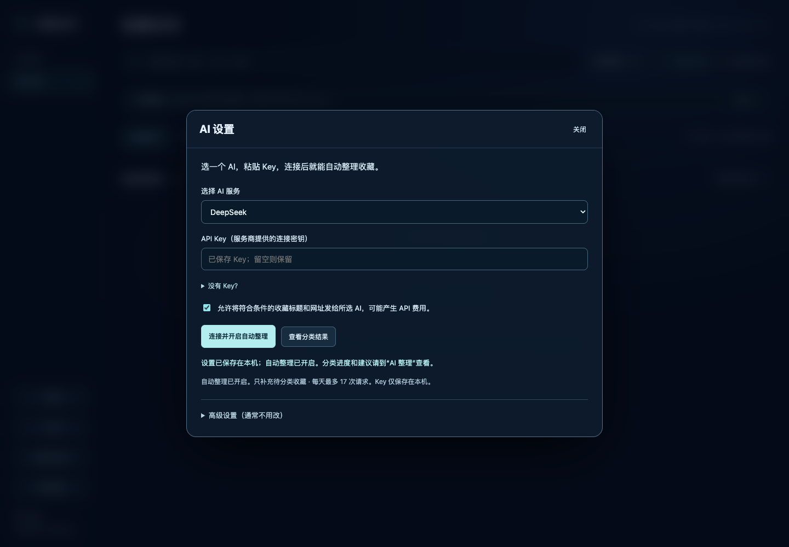

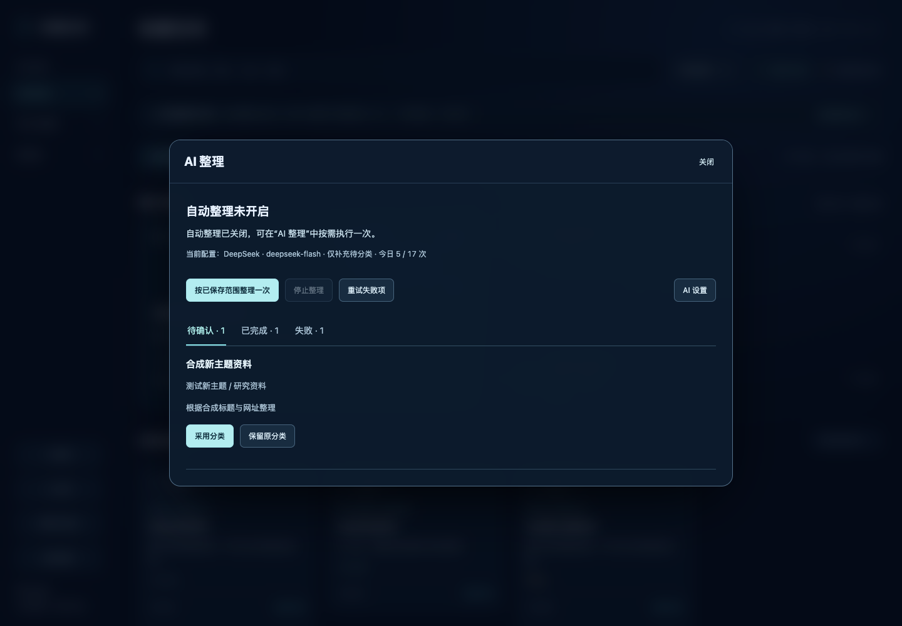

首页状态栏会显示“未配置”“未开启”“排队中”“正在整理”“待确认”或具体阻塞原因，配置完整时点击进入“AI 整理”；缺少 Key 或授权时进入“AI 设置”。卡片也标明当前状态，规则分类、手动分类与私密链接排除会单独说明。

开启并保存后，会补处理已有的待分类收藏；以后新增或修改收藏时，先执行本机规则，符合所选范围的收藏再进入 AI 队列。无需保持收藏页面打开，但浏览器需要运行。达到日上限时，自动整理会在次日恢复；暂停后不会自动恢复。Key 保存在当前浏览器的本机数据库里，关闭页面或重启浏览器后仍保留，不进入源码或 Git。

默认只补充待分类收藏。手动分类、自定义规则及已有导入分类优先保留；AI 新大类和低把握结果进入“AI 整理 → 待确认”。“已完成”显示最近20条 AI 分类结果；“失败”展示错误与重试入口。可以随时停止任务或清除所选服务的 Key。

模型 API 可能收费；每日上限统计请求次数，包含测试和重试，并非金额上限。模型名称、账户权限和地区可用性以服务商为准。不要把聊天产品订阅当作 API 额度。

## 数据与权限

收藏原始数据属于浏览器。分类、规则、删除恢复记录及 AI 配置保存在当前浏览器扩展的 IndexedDB 中。Key 也存于本机扩展数据，**没有系统钥匙串级别的加密保护**。

不开启 AI 时，插件不向模型服务发送请求。启用后，符合筛选条件的标题、网址及分类名称会直接发给所选服务。常见私密文档、内网和带参数网址会被保守排除，但过滤无法识别所有私人内容。详情见 [隐私说明](PRIVACY.md)。

## 当前边界

- Chrome 与 Edge 目前各自读取自己的收藏，尚无跨浏览器互相同步；本轮自动化验证使用隔离 Chromium，Edge 尚未单独验收。
- 通用包不附带任何个人收藏、图标或截图，也没有自动抓取网页预览图的能力。新安装的卡片可能没有图片；请勿用个人预览包替代公开包。
- 尚无完整的插件数据导出/导入界面。卸载前请保留浏览器收藏备份；浏览器收藏导出不包含插件分类、规则和恢复记录。
- 自动化测试覆盖规则、AI 协议与队列，以及浏览器内的编辑、删除恢复。六家协议测试使用模拟响应；DeepSeek 另做过三个公开示例的真实调用，其余五家尚未做真实账户验证。

## 开发与测试

`extension/` 就是可读、可直接安装的源码，不需要编译。修改 JS、CSS 或 HTML 后重新加载扩展。

基础测试不依赖第三方包：

```sh
node tests/run.cjs
node scripts/check-release.cjs
```

浏览器测试需要 Node.js 20 或更新版本：

```sh
npm ci
npx playwright install chromium
npm run test:browser
```

这些测试使用临时浏览器配置和合成收藏，不接触你的日常 Chrome 数据，不使用真实 API Key，不产生模型费用。扩展测试按 [Playwright 官方方法](https://playwright.dev/docs/chrome-extensions) 启动 Chromium。

复现演示截图和录屏见 [演示素材说明](docs/DEMO.md)。

贡献方式见 [CONTRIBUTING.md](CONTRIBUTING.md)，测试范围见 [docs/VALIDATION.md](docs/VALIDATION.md)。提交问题时请使用虚构收藏，别贴 Key、完整书签导出或私人网址。

## 许可证

[MIT](LICENSE)。
